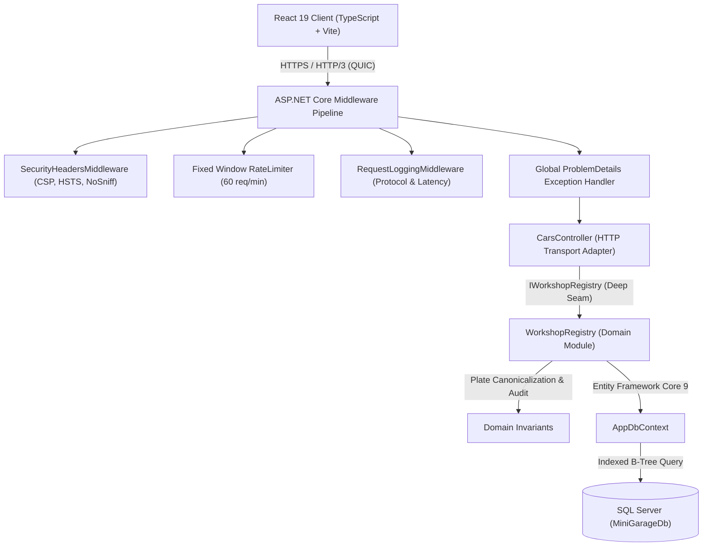

# 🔧 Mini Garage Workshop API & React Client

[](https://github.com/Elhendawy-1/MiniGarage-Workshop-Api/actions/workflows/ci.yml)
[](https://dotnet.microsoft.com/)
[](https://react.dev/)
[](https://www.typescriptlang.org/)
[](https://www.microsoft.com/sql-server/)
[-brightgreen)](https://learn.microsoft.com/aspnet/core/fundamentals/servers/kestrel/http3)
[](LICENSE)

> **Learning & Practice Project**:  
> This project was built as a comprehensive hands-on practice exercise to study, review, and solidify core concepts learned from an **ASP.NET Core Web API** course. While keeping the domain intentionally focused on a small car repair workshop, the application is engineered from end-to-end using production-grade patterns, clean architecture seams, modern frontend practices, and automated DevSecOps pipelines.

---

## 📌 Project Overview & Objectives

The goal of this application is to manage vehicles registered at a small auto repair garage while demonstrating real-world implementations of:

- **ASP.NET Core 9 Web API** with Controller routing and action results (`200 OK`, `201 CreatedAtAction`, `204 NoContent`, `400 BadRequest`, `401 Unauthorized`, `404 NotFound`).
- **HTTP/3 over QUIC** support alongside HTTP/1.1 and HTTP/2 on Kestrel.
- **Deep Domain Architecture** using the `IWorkshopRegistry` module to isolate business rules from HTTP transport.
- **Entity Framework Core 9 & SQL Server** persistence with database migrations, index optimization (`IX_Cars_CreatedAt`), and asynchronous operations (`ToListAsync`, `FirstOrDefaultAsync`, `SaveChangesAsync`).
- **DTOs, Model Binding & Validation** with Data Annotations and plate canonicalization.
- **Security & DevSecOps** with built-in Rate Limiting, Strict Security Headers (CSP, HSTS, NoSniff), Admin API Key Authorization (`X-Admin-Key`), Gitleaks, and TruffleHog scanning.
- **Interactive React 19 Frontend Client** featuring live filtering, KPI metric strips, modal management, and accessible WCAG 2.1 AA compliant UI.
- **Automated Testing**: 47 automated tests covering backend xUnit tests, React Testing Library + MSW frontend tests, and `agent-browser` CDP browser automation.

---

## 🏛️ System Architecture



---

## 🚗 Domain Concepts & Entity Model

The domain centers around a single core entity: **`Car`**.

| Property | Type | Description |
|---|---|---|
| `Id` | `int` | Primary Key (Identity) |
| `OwnerName` | `string` | Customer full name (Required, 2-100 characters) |
| `CarModel` | `string` | Vehicle make and model (Required, 2-100 characters) |
| `LicensePlate` | `string` | Canonicalized uppercase plate (Required, e.g. `DXB-7788`, `KSA-1020`) |
| `ProblemDescription` | `string` | Reported symptoms or requested maintenance (5-500 characters) |
| `RepairStatus` | `enum` | Workshop status: `Pending` (0), `InProgress` (1), `Completed` (2) |
| `CreatedAt` | `DateTime` | UTC timestamp of intake (Indexed: `IX_Cars_CreatedAt`) |

---

## 📡 REST API Specification

| HTTP Method | Endpoint | Description | Auth Required | Status Codes |
|---|---|---|:---:|---|
| `GET` | `/api/cars` | Retrieve all registered vehicles | No | `200 OK` |
| `GET` | `/api/cars/{id}` | Retrieve a single vehicle by ID | No | `200 OK`, `404 NotFound` |
| `POST` | `/api/cars` | Register a new vehicle | No | `201 Created`, `400 BadRequest` |
| `PUT` | `/api/cars/{id}` | Update vehicle details & status | No | `200 OK`, `400 BadRequest`, `404 NotFound` |
| `DELETE` | `/api/cars/{id}` | Permanently retire vehicle | **Yes** (`X-Admin-Key`) | `204 NoContent`, `401 Unauthorized`, `404 NotFound` |

> **Development Admin Key**: `garage-admin-secret-2026` (passed via `X-Admin-Key` header).

---

## 🧪 Comprehensive Test Suite (47 Automated Tests)

| Scope | Framework / Tool | Test Count | Status |
|---|---|:---:|:---:|
| **Backend Integration & Security** | xUnit 2.9 + `WebApplicationFactory` | 27 | ✅ Passed |
| **Domain Module Unit Tests** | xUnit 2.9 + InMemory EF Core | 5 | ✅ Passed |
| **Frontend Component & Unit** | Vitest + React Testing Library + MSW | 15 | ✅ Passed |
| **End-to-End Browser Automation** | `agent-browser` (Chromium via CDP) | 8 Scenarios | ✅ Passed |
| **Accessibility Audit (a11y)** | Deque Axe-Core 4.12.1 | 39 Passes / 0 Violations | ✅ Passed |

---

## 🚀 Getting Started Locally

### Prerequisites
- [.NET 9.0 SDK](https://dotnet.microsoft.com/download/dotnet/9.0)
- [Node.js 20+ & npm](https://nodejs.org/)
- [SQL Server](https://www.microsoft.com/sql-server/) (LocalDB or standard instance)
- [Git](https://git-scm.com/)

---

### 1. Clone the Repository
```bash
git clone https://github.com/Elhendawy-1/MiniGarage-Workshop-Api.git
cd MiniGarage-Workshop-Api
```

---

### 2. Configure Database Connection
Review the connection string in `MiniGarage.Api/appsettings.json`:
```json
"ConnectionStrings": {
  "DefaultConnection": "Server=localhost;Database=MiniGarageDb;Trusted_Connection=True;TrustServerCertificate=True"
}
```

Apply migrations to create the database and tables:
```powershell
cd MiniGarage.Api
dotnet ef database update
cd ..
```

---

### 3. Run the Backend API & Integrated Frontend
The backend is configured to serve the pre-built React production dashboard directly from `wwwroot`:

```powershell
dotnet run --project MiniGarage.Api
```

Once started:
- 🌐 **Workshop Dashboard (React UI)**: [https://localhost:7299/](https://localhost:7299/)
- 📖 **Swagger OpenAPI Documentation**: [https://localhost:7299/swagger](https://localhost:7299/swagger)
- 🔌 **Plain HTTP Endpoint**: [http://localhost:5065/](http://localhost:5065/)

---

### 4. Run React Client in Development Mode (Optional)
If you want to edit the React frontend with Vite Hot Module Replacement (HMR):

```powershell
cd MiniGarage.Client
npm install
npm run dev
```
Open [http://localhost:5173/](http://localhost:5173/) in your browser.

---

### 5. Running Automated Tests

#### Backend Tests (xUnit)
```powershell
# When server is not running:
dotnet test MiniGarage.slnx

# When server is already running in background (avoids file lock on .exe):
dotnet test MiniGarage.slnx --no-build
```

#### Frontend Tests (Vitest + MSW)
```powershell
cd MiniGarage.Client
npm test
```

---

## 🔒 DevSecOps & CI/CD Pipeline

The project includes an enterprise-style GitHub Actions pipeline ([`.github/workflows/ci.yml`](.github/workflows/ci.yml)):
1. **Pre-Deployment Security Gate**: Scans git history for leaked credentials using **Gitleaks** (with custom [`.gitleaks.toml`](.gitleaks.toml) rules) and **TruffleHog**.
2. **Backend CI Gate**: Builds the .NET 9 solution and executes all xUnit tests with code coverage collection.
3. **Frontend CI Gate**: Typechecks TypeScript, builds the Vite production bundle, and executes Vitest component tests with MSW network mocking.

---

## 📄 License
This project is open-source and available under the [MIT License](LICENSE).
